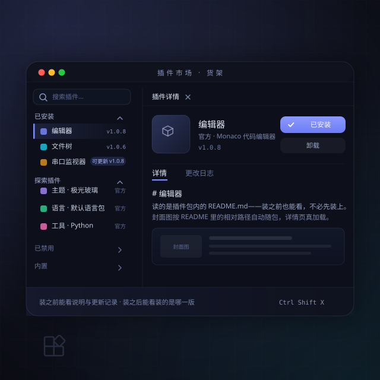

# Marketplace

Browse, install, and manage plugins



## What it does

- Sidebar / panel surfaces: Marketplace, Plugin Details.
- 22 commands, available from the Command Palette and the Plugin Store's Features tab.
- 3 settings, editable in Settings.

## Views

- **Search**
- **Installed**
- **Explore**
- **Disabled**
- **Built-in**
- **Plugin Details**
- **Confirm Install**
- **Enter license key**
- **Plugin Store**

## Commands

| Command | What it does |
|:--|:--|
| `marketplace.addSource` — Add Marketplace Source | Add an author marketplace source (the repository root must contain marketplace.json): read existing sources, reject empty / non-http(s) / official / already-listed values, then persist to marketplace.marketplaceSources; a config change reloads the catalog. Returns one of: added {ok:true,added}, no change {ok:true,noop:true,reason:official|duplicate}, invalid call {ok:false,noop:true,reason:empty|bad-url}. |
| `marketplace.openStore` — Open Plugin Store | Open (or focus) the Plugin Store tab and reset navigation to the home page. Returns {ok, tabId}; the shell's openOrFocus provides the real tab id (empty string on timeout/no event). |
| `marketplace.openRepoAll` — View all plugins | Open the Plugin Store at All Plugins for the current repository (currentRepo): a row of repository cards plus the full plugin grid. Returns {ok, tabId}. |
| `marketplace.openCategory` — Open Category | Open the Plugin Store at a category page (rail slug such as development/hardware/themes); optionally pre-filter by authorId/official for an author or official store's More link. Returns {ok, tabId}. |
| `marketplace.openRank` — Open leaderboard | Open the Plugin Store at Rankings (top 50 downloads across all sources). Returns {ok, tabId}. |
| `marketplace.openAuthors` — Open Authors page | Open the Plugin Store at the Authors page (all author cards). Returns {ok, tabId}. |
| `marketplace.openLibrary` — Open My Library | Open the Plugin Store at My Library. Returns {ok, tabId}. |
| `marketplace.openAuthor` — Open Author Page | Open the Plugin Store at an author's home page; optionally target one of their repositories with repoId. Returns {ok, tabId}. |
| `marketplace.openPlugin` — Open Plugin Details | Open plugin details in a new tab (pinned:true by default so preview replacement does not reuse it; the title comes from the catalog entry, then the installed manifest name, then pluginId). Returns {ok, tabId}; create is fire-and-forget, so tabId is always an empty string. |
| `marketplace.openSources` — Manage sources | Open the Plugin Store at the Authors page in Manage Sources mode (sources live inside that page, not a separate page). Returns {ok, tabId}. |
| `marketplace.search` — Search Plugin Store | Set the store search query (synced with the sidebar groups) and open the search page. Returns {ok, tabId}. |
| `marketplace.getState` — Read marketplace state | Read-only: return the effective route (authorId/repoId/query), per-page navigation commands, catalog entries (price/category/author/source/local state/capabilities), collections, authors with repositories/plugins, sources and counts. This is the single AI read surface—do not scrape screenshots or the DOM. |
| `marketplace.addLocalPlugin` — Add Local Plugin | Install a plugin from a local folder or .linkdesk-plugin package (reuses pluginManager.installFromDirectory: validate/copy to userData/plugins/register, the same pipeline as a network install); on success record it in pluginState localInstalls for source tracing. Returns {ok, reason?} (reason: empty|unavailable|bad-manifest|unsafe-id|core-forbidden|exists|io). |
| `marketplace.removeSource` — Remove Marketplace Source | Remove an author source from marketplace.marketplaceSources (by url/path identity or array index). Other records keep their original shape (no normalization rewrite); the official source is never removable (passing it makes the call invalid). Returns {ok, reason?} (reason: bad-arg|not-found|official). |
| `marketplace.checkUpdates` — Check for Plugin Updates | Manually check installed plugins for updates (the only action is services/updateCheck: force-refresh the catalog, run discovery, reproject the catalog; it only discovers/records/notifies and never authorizes an automatic update). Returns {ok, count} (ok=false when the catalog is unreachable or disk state is untrustworthy; count = updatable plugins). |
| `marketplace.refreshCatalog` — Refresh Catalog | Force-refresh the catalog (clear the five-minute cache, reload all sources, reproject; this is separate from Check for Updates and does not run version discovery). Returns {ok, changed} (changed = the catalog content signature changed; false when identical). |
| `marketplace.markAllRead` — Mark All as Read | Clear discovery dots (category/author items; never update-count badges): merge unread keys from the current catalog into pluginState discoverReads and advance the time anchor. Returns {cleared, reason?} (cleared = dots actually cleared). |
| `marketplace.setViewPrefs` — Set View Preferences | Remember the view mode/sort (pluginState marketplace.ui.prefs, persisted across restarts, idempotent). page=lib|author|cat; view=grid|list; sort depends on the page: lib=name|updated|size|source|author|repo, cat=dl|upd|az|author|repo, author=name|plugins|repos. Never stored in contributes.configuration. Returns {ok, reason?}. |
| `marketplace.setSourcesDefaultCollapsed` — Default collapse source groups | Set whether the author/official groups on the Sources page start collapsed (true = collapsed by default). Persists marketplace.sourcesDefaultCollapsed; the Settings page edits the same key. Returns {ok, collapsed} or {ok:false, reason}. |
| `marketplace.swapAuthors` — Swap author order | Swap two author containers (the single source of truth is the marketplace.marketplaceSources array order; drag-and-drop and command calls share one swap function). Returns {ok:true, authorOrder, repoOrder} or {ok:false, reason: bad-arg|not-found|same}. The local plugin group does not participate. |
| `marketplace.swapRepos` — Swap repository order | Swap two repositories within one author (cross-author is rejected; the official core repo is locked first in the official group and cannot be swapped). Returns {ok:true, authorOrder, repoOrder} or {ok:false, reason: bad-arg|not-found|same|locked|cross-author}. |
| `marketplace.getOrder` — Read market order | Read the author container order and each author's repository order (the single source of truth is the marketplace.marketplaceSources array order; the official core repo is always first in the official group; the local group does not participate). Returns {ok:true, authorOrder, repoOrder}. |

## Settings

- **Open the store when clicking the marketplace icon** (`marketplace.openTabOnIcon`) — Off by default: clicking the marketplace icon only switches the sidebar. Turn on to also open the Plugin Store tab.
- **Collapse source groups by default** (`marketplace.sourcesDefaultCollapsed`) — When opening Sources, collapse official/author groups by default (click a group header to expand). The command marketplace.setSourcesDefaultCollapsed writes the same key.
- **Sources** (`marketplace.marketplaceSources`) — Which catalogs the store pulls from. The official catalog is built in — add an author repo URL to discover that author's plugins (the repo root needs a marketplace.json).

## Install

Open the Plugin Store, find this plugin, and click Install. For offline use, install the `.linkdesk-plugin` package from disk.

## Development

```bash
npm install
npm run dev      # preview in the dev host
npm run lint     # eslint + manifest i18n completeness
npm run verify   # full repository gate
npm run build    # produce the .linkdesk-plugin package
npm run publish  # GitHub Release + catalog entry
```

See the repository root `README.md` for the Chinese documentation and the full directory contract.
